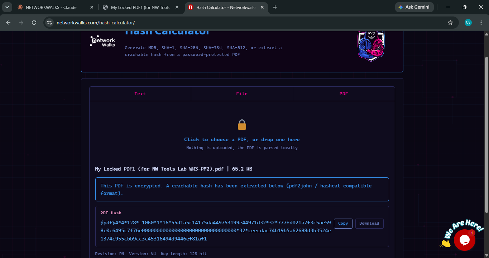
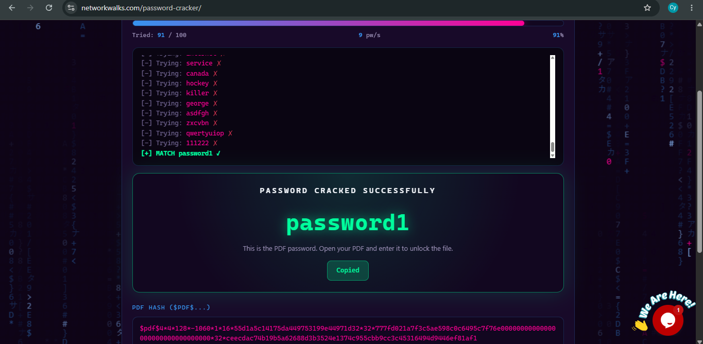
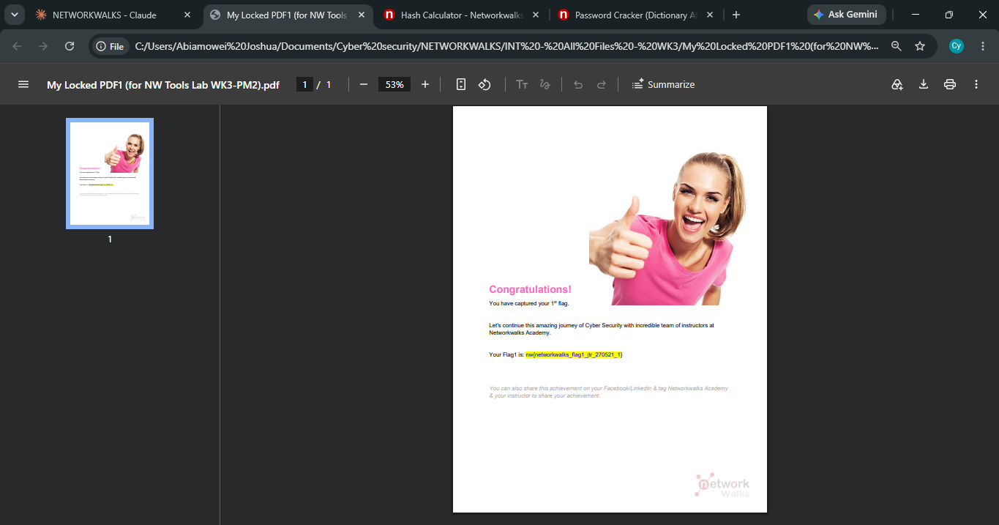
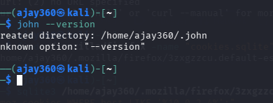
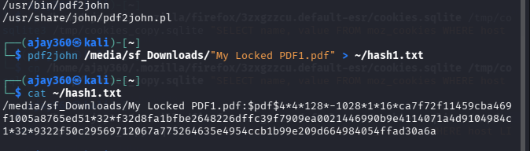
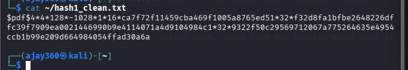
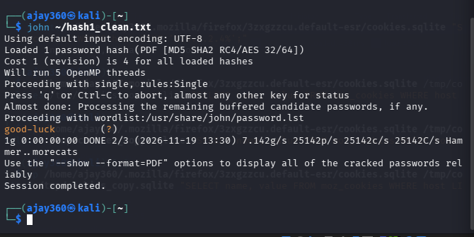
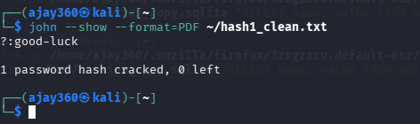
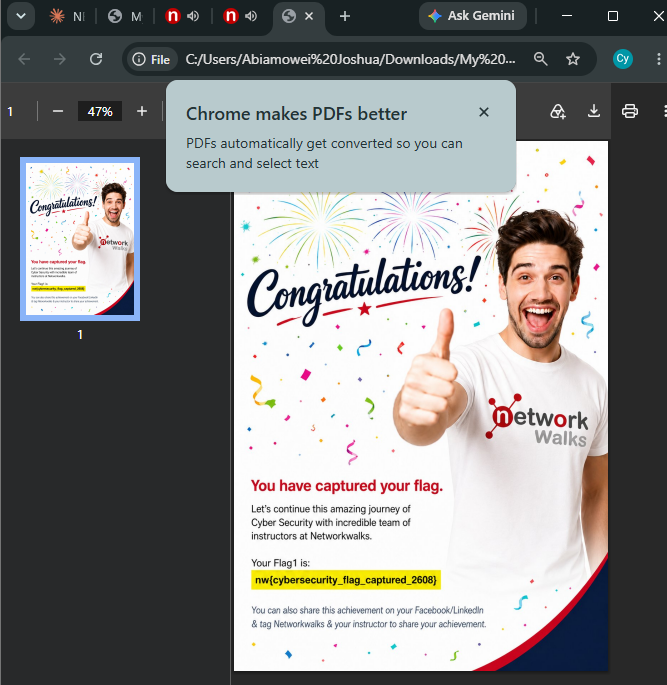

# PASSWORD CRACKING REPORT

**Week 3 — PM1 & PM2**

W3-PM1 & W3-PM2 | CYBERSECURITY | NETWORKWALKS

| Field | Detail |
|---|---|
| **Pentester Name (Cybersecurity Professional)** | Joshua Abiamowei |
| **Program/Batch** | B084 - Networkwalks |
| **Date** | 19 November 2026 |
| **Modules completed** | W3-PM1 (Password Cracking with JTR)<br>W3-PM2 (Password Cracking with Networkwalks Tools) |
| **Target files** | Two password-protected PDF files supplied by Networkwalks for this lab: `My Locked PDF1.pdf` (PM1) and `My Locked PDF1 (for NW Tools Lab WK3-PM2).pdf` (PM2) |
| **Permission secured?** | Yes. The files were provided by Networkwalks specifically for this exercise, and all cracking was performed on my own PC/VM |

## 1. Liability Disclaimer

These activities were performed only on files supplied for this training exercise, on my own equipment. These materials are for education and research purposes only. Do not use anything from here to break the law. The instructor, the authors and Networkwalks are not responsible for what anyone does with this knowledge. Every action is the responsibility of the person who takes it.

## 2. Introduction

This report covers the two essential modules of Week 3: recovering the password of a locked PDF file using two different methods. In W3-PM2, I used Networkwalks' own browser-based Hash Calculator and Password Cracker. In W3-PM1, I used John the Ripper (JTR), a dedicated password-cracking tool, on Kali Linux. Both approaches rely on the same idea: extract a hash from the locked file, then try candidate passwords against that hash until one matches.

## 3. Tools Used

| Tool | Purpose |
|---|---|
| Networkwalks Hash Calculator (web) | Extract a crackable `$pdf$` hash from a locked PDF |
| Networkwalks Password Cracker (web) | Try a dictionary of passwords against the extracted hash |
| `pdf2john` (Kali Linux) | Extract a crackable hash from a locked PDF for use with John |
| John the Ripper (`john`) | Crack the password from the extracted hash using its wordlist |

## 4. Activities Performed

### 4.1 W3-PM2: Password Cracking with Networkwalks Tools

**Step 1 — Extract the hash.** I opened the Networkwalks Hash Calculator (`networkwalks.com/hash-calculator`), selected the **PDF** tab, and uploaded `My Locked PDF1 (for NW Tools Lab WK3-PM2).pdf`. The tool detected the PDF as encrypted and extracted a crackable hash in `$pdf$...` format directly in the browser.

**Step 2 — Crack the password.** I copied the hash and pasted it into the Networkwalks Password Cracker (`networkwalks.com/password-cracker`), then ran the attack against the built-in 100-password list.

**Result:** the password was found after 91 of 100 attempts.

```
Password: password1
```

**Step 3 — Confirm.** I opened the locked PDF and entered `password1`. The file unlocked and showed:

```
Flag1: nw{networkwalks_flag1_jtr_270521_1}
```

### 4.2 W3-PM1: Password Cracking with John the Ripper

I used John the Ripper, which comes pre-installed in Kali Linux, against the second file, `My Locked PDF1.pdf`.

**Step 1 — Confirm John is available.**

```
john --version
```

**Step 2 — Extract a crackable hash from the PDF.**

```
pdf2john /media/sf_Downloads/"My Locked PDF1.pdf" > ~/hash1.txt
```

The output included the file path before the hash, so I removed it to leave only the hash itself:

```
cut -d: -f2 ~/hash1.txt > ~/hash1_clean.txt
```

**Step 3 — Run John the Ripper against the hash.**

```
john ~/hash1_clean.txt
```

John used its default wordlist and found a match:

```
good-luck (?)
```

**Step 4 — Display the cracked password clearly.**

```
john --show --format=PDF ~/hash1_clean.txt
```

**Result:**

```
Password: good-luck
1 password hash cracked, 0 left
```

**Step 5 — Confirm.** I opened `My Locked PDF1.pdf` and entered `good-luck`. The file unlocked and showed:

```
Flag1: nw{cybersecurity_flag_captured_2608}
```

## 5. Risk Analysis / Impact

| # | Risk / Finding | Evidence / Observation | Potential Impact | Risk Level |
|---|---|---|---|---|
| 1 | Password-protected PDFs can be cracked with a dictionary attack | Both files were cracked using small, standard wordlists (100 built-in passwords, and John's default list) | Weak passwords on sensitive files offer little real protection | **Medium** |
| 2 | Passwords based on common words and patterns are cracked quickly | `password1` (a well-known weak pattern) and `good-luck` (a plain dictionary phrase) were both found almost immediately | Dictionary and common-pattern passwords are among the fastest to break | **Medium** |
| 3 | A file's encryption can be bypassed once its hash is exposed | Both tools worked by extracting a hash from the file metadata, not by brute-forcing the file itself | Anyone who can extract the hash can attempt to crack it offline, without limits on attempts | **Low** |

**Risk level key:** Critical, Medium, Low

These findings came from a controlled training exercise using files supplied for that purpose. They illustrate password-cracking technique and are not an assessment of any production system.

## 6. Recommendations

1. **Use long, random passwords** instead of single dictionary words or common patterns like `password1`.
2. **Avoid predictable phrases**, even multi-word ones like `good-luck`, since they are also in common wordlists.
3. **Use a password manager** to generate and store strong, unique passwords for protected documents.
4. **Treat PDF password protection as weak on its own** — it slows down casual access but does not stand up to a dedicated dictionary or brute-force attack.
5. **Limit how widely sensitive protected files are shared**, since anyone with a copy can attempt offline cracking with no rate limit.

## 7. Conclusion

In Week 3, I completed both essential modules on password cracking. Using the Networkwalks web tools, I extracted a hash and cracked a password in under a hundred attempts. Using John the Ripper on Kali Linux, I extracted a hash with `pdf2john`, cleaned it into the format John expects, and cracked a second password using John's default wordlist.

Both methods reached the same conclusion from different directions: a weak or common password offers very little protection once an attacker can get the password hash out of a file. Strong, unpredictable passwords remain the real defence.

## 8. Evidences Collected

**W3-PM2 — Hash Calculator result**



**W3-PM2 — Password Cracker result (password1)**



**W3-PM2 — Unlocked PDF with flag**



**W3-PM1 — John the Ripper availability check**



**W3-PM1 — Hash extracted with pdf2john**



**W3-PM1 — Cleaned hash file**



**W3-PM1 — John the Ripper crack result (good-luck)**



**W3-PM1 — Confirmed password with --show**



**W3-PM1 — Unlocked PDF with flag**



-End-

---

**Author:** Joshua Abiamowei, Cybersecurity Intern, Batch B084

**Program:** Cybersecurity program at Networkwalks | **Week:** 03 | **Repository:** GitHub
